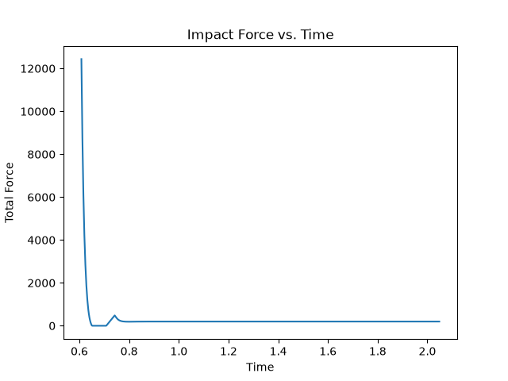
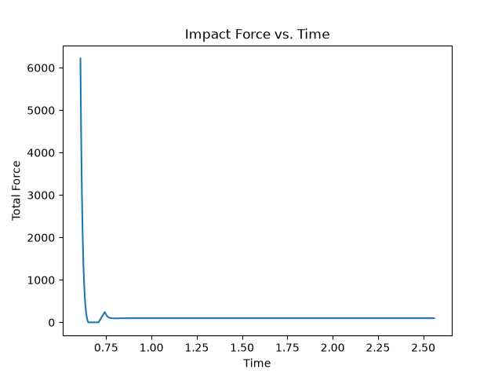

# 2026-10-30 MuJoCo 初次运行与试错记录

## 1. 试错实录

**实验 A：修改几何与物理属性**
- **操作**：将 `rgba="1 0 0 1"` 改为 `0 1 0 1`，将质量参数修改为 `mass="20"`。
- **现象**：球体渲染颜色变为绿色。下落过程的视觉速度无明显变化。
- **我的思考**：根据牛顿经典力学，在仿真环境中重力加速度 \(g\) 恒定，故下落时间一致。但根据动量定理，质量增大意味着对地面的冲击力增大。不过仅凭视觉无法严谨判断碰撞形变（刚体引擎默认无形变），后续需打印接触力（efc_force）数值进行验证。

**实验 B：关于 time.sleep 的理解与踩坑**

**我一开始的直觉（自己的猜想）**：
sleep 类似于一个休息指令，出现就代表让机器休息一会再计算。参数如果是 0.01 就是休息 0.01 秒。如果没了这个指令，计算机不休息，本来计算速度就极快，那么仿真过程就会一瞬间完成。所以我当时以为，这玩意的目的就是为了让“仿真里的时间”与“真实世界的时间”一致。

**实测现象**：
打印 `model.opt.timestep` 发现，引擎每步只走 `0.002` 秒的仿真时间。这意味着现实世界休息了 0.01 秒，仿真世界才走了 0.002 秒，屏幕上的小球掉得比现实慢了 5 倍。我原来以为的“时间对齐”根本不成立。

**修改与存疑**：
尝试把代码改成 `time.sleep(0.002)`，肉眼看着速度确实变快了，但肉眼不能代替实际，AI提醒程序本身执行 `mj_step`（物理计算）和 `viewer.sync()`（渲染画面）也是需要消耗真实时间的。所以“肉眼看着变快了”不代表真正做到了 1:1 实时对齐。

**下一步验证计划**：
目前在思考怎么验证真实的时间流速。可以引入 `time.time()` 获取真实世界的时间，与引擎内部的 `data.time` 进行对比打印，准备后续尝试用数据看看到底差了多少。

## 2. 今日实操记录：电机配置与悬停

**实验 C：添加执行器与报错解决**
- **操作**：在 XML 中 `<worldbody>` 外添加 `<actuator>` 标签，写入 `<motor joint="ball_joint" gear="0 0 1 0 0 0" />`。
- **报错**：运行时终端报错 `ValueError: Error: unknown transmission target 'ball_joint' for actuator id = 0`。
- **思考与解决**：去检查 XML，发现第 13 行的 `<joint>` 只写了 `type="free"`，没有定义 `name`。加上 `name="ball_joint"` 后，报错消失。

**实验 D：计算重力实现悬停**
- **操作**：将球的质量设为 20kg。计算重力 \(G = mg = 20 \times 9.81 = 196.2\) N。在 `while` 循环中，给 `data.ctrl[0]` 赋值 196.2。
- **现象**：运行程序，绿球稳稳停在了初始高度（Z=2），没有继续下落，也没有飞走。(AI提醒是魔法数字，后续要进一步排查)

**实验 E：尝试多变量控制**
- **操作**：想尝试 X 和 Y 方向的控制，在 `<actuator>` 中增加了 3 个 `<motor>`，分别对应 `gear="1 0 0 0 0 0"`、`gear="0 1 0 0 0 0"` 和 `gear="0 0 1 0 0 0"`。
- **现象与思考**：要控制三个方向，就得手写 `data.ctrl[0]`、`data.ctrl[1]`、`data.ctrl[2]`。如果以后控制几十个关节的机器人，这样手写代码非常繁琐，可以引入矩阵运算。

**实验 H：Reset 机制与开/闭环控制**

**1. 操作与现象**
* **开环（循环外赋值）**：小球悬浮。点击 Reset 后，小球坠落。
* **闭环（循环内赋值）**：小球悬浮。点击 Reset 后，小球保持悬浮。

**2. 底层原理**
MuJoCo 的 Reset 动作会将所有控制指令（`data.ctrl`）清零。写在循环外只发一次指令，清零后即失效；写在 `while` 循环内部，就会每一帧不断施加力的作用。

**3. 核心顿悟**
* **控制指令必须持续下发**：真实物理系统随时面临扰动，绝不能只发一次指令就撒手不管。
* **控制频率的概念**：mj_step这个函数计算把物理过程往前推动了一个周期，每次固定推进timestep(0.002s)这么长的时间。

# 2026-10-31 调试和重写记录
## 费曼式重写注释和日志

**1.注释重写出现的问题及调试**
- **我的错误情况**: model = mujoco.MjModel.from_xml_string后的左括号为了美观强行放置在下一行，触发TypeError报错，AI告诉我函数左括号应当紧跟函数体，修复后，XML字符串的注释格式错误再次报错ValueError，查询后解决，并确定了XML的注释格式为<!--注释-->
- **修改了部分注释**：sleep(0.01) 不是“大致匹配真实时间”，是慢 5 倍
                     gear 不是“代表力”，是系数，力 = ctrl × gear
                     顺手给 196.2 旁边写一行：# = 20 kg × 9.81，改质量必须重算,应当借助函数知识避免魔法数字，后续尝试
- **遗留问题**：print：挪到降频打印（比如 data.time 每过 0.1 s 打一次），否则 100 行/秒刷屏，拖慢计算速度

**2.AI问答学习**:
- **底层理解**：理解了MjModel MjData mj_step在底层的含义，以及“=”在data与MjData model与MjModel之间的作用，寻找资源基本了解了python函数的部分基本知识，但底层mj_step和data的传参方式涉及指针，后续能够补上。
- **时间真相**：原来不知道time.sleep的内涵随意使用，讨论后明白是一个延迟计算的工具，time.sleep(0.01)时意味着仿真时间比现实慢5倍，mj_step这个函数计算把物理过程往前推动了一个周期，每次固定推进timestep(0.002s)这么长的时间。
- **数据解剖**：打印len(data.qpos)，发现值为7，说明小球有7个状态量，明确了底层数组的对应关系从0开始三个分别对应x y z 轴坐标，其余四个查询后明白叫做四元量，共同决定了球在空间中的朝向和姿态，后续需要了解

# 2026-11-2 遗留问题解决
**1.魔法数字**
- **过往问题**：直接把计算好的值赋给data.ctrl，一旦改变质量立马就得手动重算重力。
- **解决方案**：使用函数————定义了一个ball_gravity(mass)函数，一旦改变质量，机器能自动利用函数计算重力大小，不用再次手动重算。（动态计算重力）
- **期间遇到的问题**：(1).语法错误：在给控制力用函数赋值时忘记了函数后面的括号和参数，已解决。
                     (2).索引错误：误以为小球质量在model.body_mass数组中索引为0，但实际为1，已修正。
                     (3).测试出现bug:打印重力发现的确是mass*9.81，但是同样赋值了这个数的控制力却消失了，小球往下掉，回忆过往测试和排查后，发现是之前测试，把Z轴控制力gear(系数)改为了0，自然力就没了，明确后解决了bug，再次运行小球重新悬浮。

**2.降频打印**
- **过往问题**：print("当前高度:",data.qpos[2])在循环体内每一帧都打印,打印大多太快，会降低计算速度。
- **解决方案**：先初始化一个变量代表上一次打印对应的时间戳，在while外初始化一个变量last_print_time = time.time()来记住刚开始的时间，然后在循环体内用if判断上次两次打印时间是否间隔了0.5秒以上，即time.time() - last_print_time > 0.5，同时这个判断成立后需要用last_print_time = time.time()刷新时间，否则if后的语句就是恒成立的了，完成之后print不再刷屏。
- **发现的问题**：运行后，发现小球z坐标在缓慢减小，即缓慢下降，起初怀疑是底层的g不是9.81，使用print(model.opt.gravity)查看后，发现的确是9.81，说明不是重力加速度数值的问题，向降频if内加入了print(data.qvel[2])来实时查看小球z方向的速度，结果发现本不该出现的速度莫名奇妙出现了，所以导致在力平衡的条件下小球匀速向下落。
- **Debug**:说明这可能是函数mj_step在控制力出现之前进行了一步计算导致小球在只受重力的情况下积分了一步，自然有了速度，原本我以为括号里的任何东西都是不会进行或者参与计算的，查询python运行机制发现只要是函数后面带了括号就必定会真实执行一次，无论是否用括号包着还是赋值给变量，理解后明白是print(mujoco.mj_step(model, data))内部的mj_step(model, data)执行了一次，让小球获得了速度，将print(mujoco.mj_step(model, data))注释掉，再次运行，小球稳稳停在z=2处。 

# 2026-11-23 过往想法尝试
## 不同质量小球落地的接触力
**解决过程**：打印data.efc_force,但是是个数组且由于接触力复杂，先行打印len(data.efc_force),明确了碰撞瞬间接触力len从0变为4，于是利用if len(...) > 0 来在碰撞瞬间开始打印接触力，来探究不同质量小球的冲击力，并且使用matplotlib绘制了两个不同质量下的接触力图如下：

20kg的小球：            

10kg的小球：          

可以看出，质量更大的小球明显对地面的冲击力更大，符合物理直觉

## 已定位并改掉的一条
- 现象：为了消掉魔法数字，我写了 ball_gravity()，里面用 model.opt.gravity[2] 算重力。
- 问题：gravity[2] 是 −9.81，不是 9.81。所以函数返回 −196.2，再乘 gear 的 +1，
  力就变成朝下的 196.2 N，小球等于被重力推两次，以 2g 往下掉。
- 改法：mg = m * (−model.opt.gravity[2])，符号反过来。
- 我现在的理解：ctrl 是“我要施加的力”，不是“重力本身”，所以要把重力的方向取反。

**这个改法有个前提，我自己得记住**
- 现在我默认“重力只沿 −Z 方向”，所以只取了一个分量、翻个符号就完事。
- 一旦要做 X 方向、Y 方向的控制，这种“单分量取反”的写法就不成立了。
- 更一般的写法应该是把重力当成一个三维向量整体取反，而不是一个个分量手写。
  （这也是我下一步做多方向控制绕不开的地方）

## 任务①：真实时间 vs 仿真时间，到底差多少

**1. 我要解决的问题**
日志 10-30 那天我写过一个计划：用 time.time() 和 data.time 对比，看看仿真世界和真实世界差了多少。
今天真正做完了，结论比我想的复杂。

**2. 一开始的假设（错的）**
- 我以为 sleep(0.01)、timestep 0.002，那每循环就差 0.008，按 80% 的亏空算，跑 10 秒大概差 8 秒左右。
- 我以为“对不齐”的原因就是计算耗时：mj_step 和 viewer.sync 要花真实时间，
  所以 sleep 应该设成 “timestep 减去计算耗时”，0.002 − 0.0004 = 0.0016。

**3. 实测数据**
第一次：sleep(0.01)，真实 10.254 s，仿真 1.970 s，差 8.284 s → 比值 0.19，慢 5 倍多。
第二次：sleep(0.0016)，真实 10.124 s，仿真 9.488 s，差 0.635 s → 比值 0.937。
第三次：sleep(0.0016)，真实 10.023 s，仿真 9.358 s，差 0.665 s → 比值 0.934。

**4. 怎么算出来的（这次是自己推的）**
- 主循环一次 mj_step 走一步，一步 0.002 s，所以仿真 9.358 s 一共走了 9.358 / 0.002 = 4679 步，
  也就是循环了 4679 次。
- 真实 10.023 s ÷ 4679 次 = 每次循环真实花 2.14 ms。
- 仿真每次只走 2.00 ms，所以每一轮亏 0.14 ms，10 秒累计亏 0.665 s。

**5. 这 0.14 ms 亏在哪**
- 单独测 time.sleep(0.0016) 跑 1000 次取平均，平均值是 2.03 ms。
- 也就是说 sleep 自己就要睡 2.03 ms，我要它睡 1.6 ms，它睡过头了 0.43 ms。
- 而 mj_step + viewer.sync 加起来只有 2.14 − 2.03 = 0.11 ms。
- 之前那个“0.0004 的计算耗时”是我用 0.0084 − 0.008 倒推出来的，不是测的，
  今天实测只有 0.11 ms，倒推的值不可信。
- （待填）三个数各是什么：0.14 是 每一轮的时间亏空（真实比仿真多花的那部分），0.43 是 sleep 睡过头的量，0.11 是 mj_step + viewer.sync 的计算耗时。

**6. 结论**
- “对齐时间”不是把 sleep 设成 0.002 就完事，
  要同时扣掉计算耗时（0.11 ms）和 sleep 自己睡不准的那部分（0.43 ms）。
- 现在慢 7%，主要是 sleep 不听话，不是引擎慢。
- 在 Windows 上 sleep 的精度本身就不受我控制，所以硬调 sleep 永远调不到严格 1:1。
- 实测值会随时间波动，只能当量级参考，不能写成固定的补偿系数。

**7. 今天的两个教训**
- 倒推 ≠ 实测。用“差了多少”反推“计算耗时多少”，会把自己骗了。
- 测量时不能把 print 放进被测区间，也不能复用变量名（t0 被覆盖过一次，导致打印的差值全是错的）。

**8. 遗留（明天/搁置）**
- 任务②：让 ctrl 从标量变成向量，至少 X、Z 两个方向。
- 慢 7% 要不要接受：视觉上看不出来，先接受，别为最后几个百分点卡住。
- time.sleep 精度有没有替代方案（不信 sleep、改用别的节拍方式），记入搁置清单。

## 任务②：多方向控制，现在连通道都没有
- ctrl 还是 data.ctrl[0] 这种硬编码下标，XML 里也只有一个 <motor>。
- 要两个方向，至少得再加一个 motor，并且 gear 要指到另一个轴上。
- 疑问：free joint 的 qpos 是 7 个（3 位置 + 4 四元数），
  gear 那 6 个数字到底对应哪 6 个自由度？我猜前 3 个是世界系的平移，
  但这只是猜，得跑一次看小球往哪个方向动才算数。

# 2026-11-24 任务②入门，两个方向的控制
## 进行X和Z方向的控制实验
**1.操作**
- 添加了一个<motor>,gear系数设置为“1 0 0 0 0 0”，让力的作用方向朝向x轴正方向，跑两个实验进行了对比，x方向上的控制力为0和为50，同时调高打印频率并将仿真退出时间设为1秒，避免错过打印时机和方便理论计算与实际对照，然后将第二个<motor>gear系数分别跑了一次前三位单独系数为1的仿真。

**2.现象**
- x控制力data.ctrl[1] = 0.0时x z 轴方向上速度都恒为0，data.qvel[3]角速度始终为0，高度保持在2；data.ctrl[1] = 50.0时，x方向上的速度逐渐增大，z 轴方向上速度恒为0，data.qvel[3]角速度始终为0，高度保持在2，这说明gear第一位是平移而非旋转，改变系数跑实际读数发现第二位和第三位也是这个规律，故gear前三位是平动。计算知道加速度为2.5 m/s²,1秒理论速度会变为2.5m/s，实际为2.390m/s,考虑之前仿真和真实时间误差，取0.934的比值计算的0.934*2.5约为2.335m/s,与实际差2%，原因是这1秒本身并不精确。

**3.结论**
- Z悬停和X恒定推力，两个ctrl下标分别管一个轴，实现了简易的双方向控制，完成了多方向控制入门，验证了gear前三个系数是平动而非旋转。